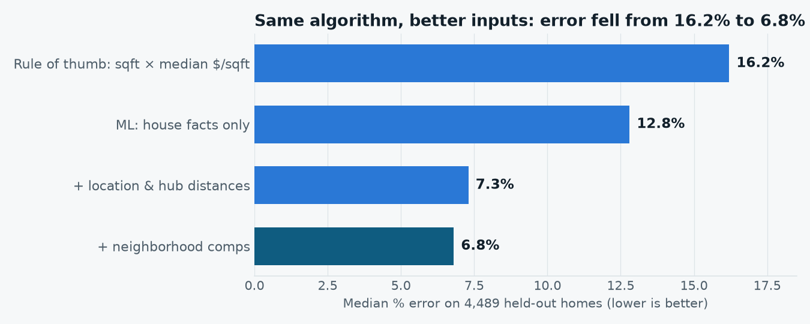
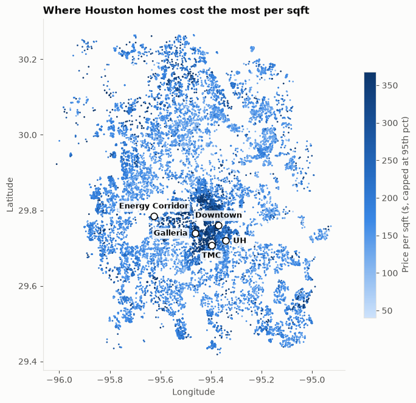

# Houston Price Check

**CodeCoogs UH AI Hackathon, Fall 2026: Track 2, Houston Housing Market Intelligence**

A machine-learning model that estimates a fair price for Houston homes from their facts and location
(median error **6.8%**, without ever seeing the list price), a price check against similar homes, and a
search that finds homes by **true monthly cost** (mortgage + Texas property tax + insurance) instead of sticker price.

**▶ Live demo (no login): https://anthony-hasan.github.io/houston-price-check/**

## Results
Gradient-boosted trees (scikit-learn `HistGradientBoostingRegressor`) on log price, scored on 4,489 homes held out from training.
Same algorithm each time; only the inputs change.

| Model | Median error | Within 10% | R² |
|---|---|---|---|
| Rule of thumb (sqft × median $/sqft) | 16.2% | 32.3% | 0.402 |
| House facts only | 12.8% | 40.6% | 0.701 |
| + location & distance to 5 job hubs | 7.3% | 62.2% | 0.846 |
| + neighborhood comps | **6.8%** | **64.5%** | **0.855** |

Zillow's Zestimate scores 3.2% on the same homes, but it uses the list price itself; this model never does.

## What's in this repo
| Path | What it is |
|---|---|
| `houston_housing_track2.ipynb` | The full project, with outputs saved: data checks, cleaning, features, training, model comparison, price check, budget search |
| `site/houston-price-check.html` | The interactive demo page (download and open in any browser) |
| `images/` | Charts used in this README |
| `requirements.txt` | Python packages, for running outside Colab |

## Run it
Click **Open in Colab** above, then **Runtime → Run all** (about 2–4 minutes). The data downloads automatically from Kaggle; no API keys needed.
Locally: `pip install -r requirements.txt`, then open the notebook in Jupyter.

## How it works
1. **Clean:** 25,922 Zillow listings → 22,442 homes. Vacant land, duplicates and outliers were dropped. Lot sizes that mixed acres and square feet were fixed, and median-filled values were treated as unknown.
2. **Features:** house facts, miles to Downtown, the Texas Medical Center, the Galleria, the Energy Corridor and UH, and neighborhood comps (the median $/sqft of the 10 nearest homes, built out-of-fold so a home never sees its own price).
3. **Train and test:** the Zestimate is left out of training (it sits within ~3% of list price, which would be leakage).
4. **Price check and budget search:** every home gets a fair value from a model that never saw it. Only homes where the model is reliable are rated: single-family homes and townhouses built 1980 or later, under 1 acre, $150k–$1.2M. That's 15,592 homes with a 5.8% typical error.

## What we learned
Our first price check flagged 2,206 "possibly underpriced" homes. Compared with Zillow, most turned out to be model mistakes:
huge lots, very old homes, manufactured homes. We limited ratings to where the model is reliable and present big gaps as
"worth a closer look", not as bargains.

## Limitations
- List prices aren't sale prices, and this is one snapshot of listings from June 2024.
- The model can't see condition, renovations or flood history.
- New-build communities share map coordinates, which flatters the neighborhood comps.
- Tax and insurance rates are Texas averages; HOA fees and flood insurance aren't in the data.

## Data
[Houston Housing Market 2024 — clean dataset](https://www.kaggle.com/datasets/mohamedalmansop/houston-housing-market-2024-clean-dataset)
(Zillow listings, June 2024), via Kaggle. Not redistributed here; the notebook downloads it.
